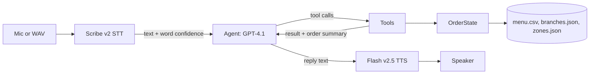
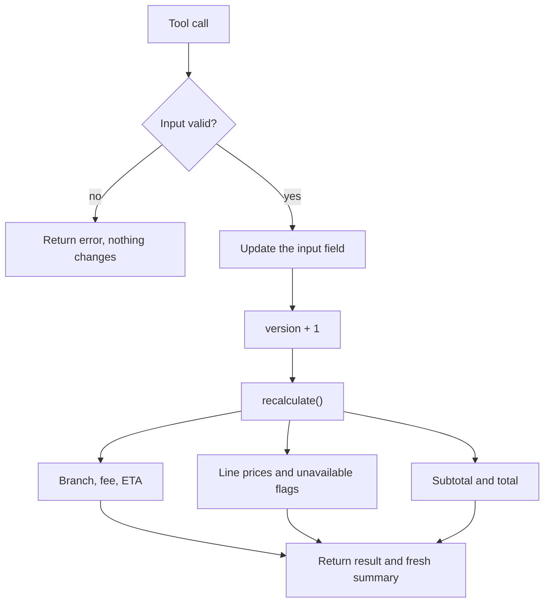
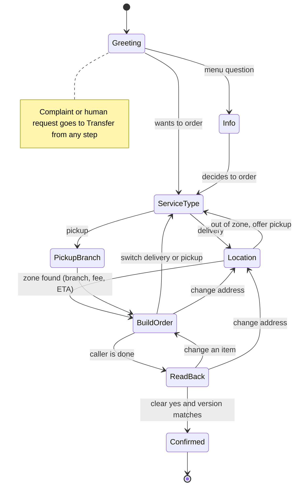
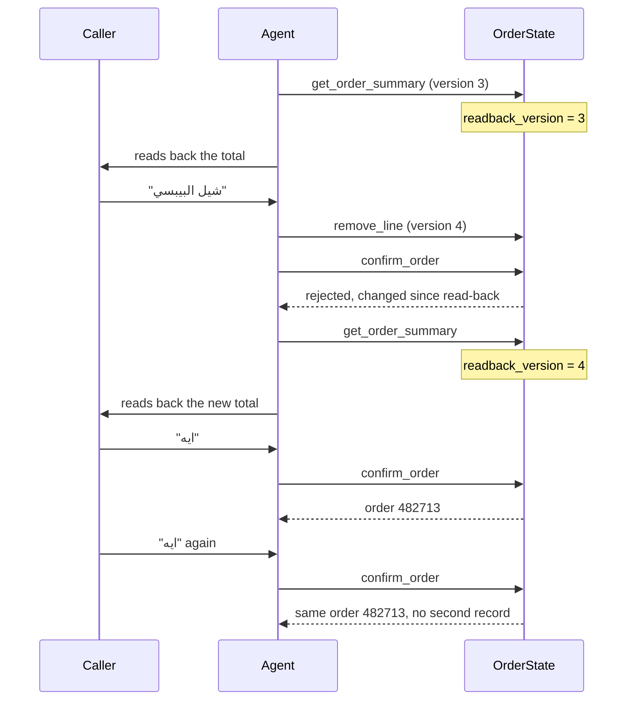
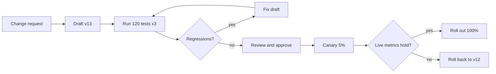

# Design

## Overview

The agent is a Python CLI that runs one voice ordering phone call in Saudi Arabic: record or load audio, transcribe it, let an LLM understand the caller and decide what to do, then speak the reply back. The one idea behind the design is a hybrid split: the LLM understands speech and phrases replies, but it never touches the order directly, code owns the order state, and the LLM can only change it by calling validated tools.

## Why Python

I haven't written much Python recently (my day to day has been Node.js with TypeScript), but it was the clear choice for this project:

- every STT, LLM and TTS provider I considered ships a first class Python SDK
- the open-source Arabic models I recommend in EVALUATION.md run on the Python ecosystem (Hugging Face / PyTorch), so a self hosted model could later replace a hosted one without changing languages

## Demo stack

- **STT:** ElevenLabs Scribe v2: lowest WER (13.2%) among five commercial  providers on an independent Saudi Arabic (Najdi & Hijazi)–English code switching benchmark. Returns a log probability per word, which the agent converts to a confidence score to decide when to confirm an address, quantity, or size with the caller. Also supports keyterm biasing, used to pass menu item names.
- **LLM:** GPT-4.1: a fast, non reasoning model with reliable tool calling, which the hybrid design depends on since the LLM can only act through tools. Natural conversation needs ~1.5s voice to voice, about 700ms time to first token for the LLM, the most accurate tool calling models in that benchmark were too slow for live voice. Tool calling accuracy also drops 5–10% when users speak Arabic, so all tool inputs are validated in code.
- **TTS:** ElevenLabs Flash v2.5 : the lowest latency ElevenLabs model (~75ms) that still lists Arabic in its supported languages, their other low latency models dropped Arabic support. Same provider account as stt to keep the demo stack simple. Requests raw PCM output instead of mp3, so playback doesn't need an extra audio decoder.
  - First choice was a shared library voice tagged with an Arabic accent, since that's closest to what a Saudi caller would expect to hear. ElevenLabs blocks free tier accounts from using shared library voices via the API (kept running into a 402 :/ ), so the demo falls back to the free tier default voice instead. None of the default voices are labeled Arabic, but flash v2.5 can still speak Arabic text through an english accented default voice. Worth a real Arabic voice before any production use.

Sources: 
- Benchmark of commercial ASR on saudi arabic-english code switching (https://benchmarklist.com/models/elevenlabs-scribe-v2/)
- ElevenLabs speech to text API reference (https://elevenlabs.io/docs/api-reference/speech-to-text/convert)
- Best LLM for AI voice agents (https://murf.ai/blog/best-llm-for-voice-ai)
- Arabic Prompts with english tools (https://arxiv.org/html/2601.05101v1)
- Best LLMs for voice agents (https://benchlm.ai/best/voice-ai-agents)
- ElevenLabs models reference, language/latency per model (https://elevenlabs.io/docs/models)


## Architecture
 
### Pipeline
 

 
 ## Data
 
**Menu (given).** 144 dishes, 12 categories, 1,728 rows. Each dish spans 8–15 rows, one per option, with the dish-level fields repeated. Two things in the CSV shaped the code:
 
- `item_price_with_option_sar` looks like a final price but only reflects one option at a time. A large pizza with extra cheese needs the base price plus every selected options' deltas, so the code sums them itself.
- Availability is per dish and per branch, while prices are the same at every branch. 111 dishes are available everywhere, the other 33 are missing at one or more branches. This is what makes the location changes after adding items scenario real.
**Branches and delivery zones (mock).** The CSV only covers the menu, so I created:
 
- `branches.json`: the 4 branch IDs from the CSV (3 in Riyadh, 1 in Jeddah), with Arabic names and a pickup prep time.
- `zones.json`: 12 real neighborhoods (8 in Riyadh, 4 in Jeddah), each mapped to a branch with a delivery fee and ETA (20–40 min). Fees and ETAs vary on purpose so changes are visible in the demo. Any location outside these zones gets "we don't deliver there, would you like pickup?"
All money is stored as integer halalas (SAR × 100), makes it easier to avoid floating point rounding errors.

## Order state
 
All order data lives in one `OrderState` object (`src/order_state.py`), split into three groups:
 
- **Inputs**, what the caller told us: service type, delivery zone, pickup branch, and cart lines (item, quantity, size, options, notes).
- **Derived**, what code calculates: branch, delivery fee, ETA, line prices, unavailable lines, subtotal, total.
- **Bookkeeping:** version, read back version, order ID, status.
Five rules keep the order correct:
 
1. **Validate first, then change.** Every change method either rejects the input and changes nothing, or updates the input, increments `version`, and calls `recalculate()`. Validation is menu-aware: the item exists, a required size is given and valid, each option group's min/max selections are respected, and no unknown options slip through.
2. **Rebuild, never patch.** `recalculate()` rebuilds every derived field from the inputs from scratch. Nothing is updated incrementally, so nothing can drift.
3. **Flag, don't delete.** Items the current branch doesn't serve stay in the cart, flagged, so the agent can tell the caller and ask what to do. If no branch is chosen yet, availability is "unknown", not "unavailable".
4. **No math in the LLM.** `summary()` includes ready made SAR strings (`total_sar: "87.50"`) computed in code, so the LLM only ever reads numbers, never computes them.
5. **Safe confirmation.** `get_order_summary()` is the read back and records the current version. `confirm_order()` only succeeds if nothing changed since the read back, the service type and location or branch are set, the cart isn't empty, and nothing is flagged unavailable. Confirming twice returns the same order ID without writing a second record, and every change method refuses once the order is confirmed.



## Customer journey
 

 
The steps aren't a fixed script. Nothing in the code directly says "you are now in step 3". The agent looks at what is missing from the order state  and asks for that.

How a read back blocks a stale or duplicate confirmation:
 



## Architecture questions

**Is this one agent, multiple agents, a state machine, a graph, or a hybrid?**

I decided to go with a hybrid. One LLM agent on top of the state object owned by the code. One agent because a single phone call doesn't need handoffs between AIs, which could introduce latency and more places for data to possibly get lost. The state machine is also not hard coded, callers tend to jump around, so the LLM handles the conversation while the code handles correctness. 

**What controls movement between steps?**
The order state controls it. The next step is whatever is still missing, like service type, location or branch, and items, so there is no step counter to get out of sync. Hard rules are enforced in code, not the prompt: `confirm_order` refuses without a matching read back, a location, and an available cart.

**What data moves between steps, and what stays behind?**
The order state moves forward: inputs, derived values and version. The agent gets a fresh compact summary every turn. What stays behind: the full menu, raw audio, old search results and old tool outputs. 

**How do you prevent stale data after the caller changes an earlier answer?**
Inputs and derived values are separate, and `recalculate()` rebuilds every derived value from the inputs after every change. Any change bumps the version which invalidates the last read back.

**How do you prevent duplicate tool calls or duplicate orders?**

- Duplicate tool calls: within one turn, if the LLM requests the exact same tool with the same arguments twice, it runs once and the second request reuses the first result.
- Duplicate orders: confirming is idempotent. The order ID is created once, and a second `confirm_order` returns the same ID without writing a second record. This matters for more than a caller saying "ايه" twice: a timeout retry could re-send a confirm that already succeeded. Every change method refuses once the order is confirmed.
- Confirming the wrong thing: the version check means the caller always confirms the latest order, and the turn check means they heard it first.

## Context and reliability

**How do you keep the 100+ item menu out of the main prompt?**
The prompt only lists the 12 category names. Dishes are reached through `search_menu` (top 5 matches), `list_category`, and `get_item_details` , so the prompt stays the same size no matter how big the menu is.

**How do you manage conversation history and context size?**
During each turn, the llm gets: the system prompt, a fresh order summary, the last 10 caller/agent exchanges, and the new caller message. Tool calls and results from earlier turns are not kept. The fresh order summary replaces them. Losing old turns loses nothing important, because everything that matters is in the order state, not the chat.

**What happens when a model returns invalid output or times out?**

- Invalid tool arguments: pydantic rejects them and the error goes back to the LLM in plain language, so it can fix the call or ask the caller. Unknown tool names return an error too.
- Runaway loops: at most 5 tool rounds per turn, then a short apology.
- Timeouts: each OpenAI call has a 10s timeout and one retry. If both fail, the agent apologizes and asks the caller to repeat, two failed turns in a row transfer the call to a human.
- The order only changes when a tool succeeds, so a failed call can't corrupt it this way. 
- STT words with confidence below 0.6 are marked in the text the llm sees, and the prompt tells it to confirm marked words that affect the order. 

**Which decisions are deterministic, and which use the LLM?**

Code (deterministic):
- Prices, total fees, ETAs
- Arabic normalization and menu search ranking
- Branch from zone, zone from neighborhood
- Avilability and unavailable flags 
- Validation of sizes and options

LLM: 
- Understanding messy speech
- Pulling items, quantities and options out of a sentence
- Choosing which tool to call
- Asking clarifying questions

**What would you improve before using this with real customers?**

- Real time streaming with voice activity detection and barging in sensitivity , instead of press Enter turns.
- A real saudi arabic voice (blocked on the free tier :/// )
- Expand the keyword maps with common transliterations, ideally built from real call transcripts.
- Retry other OpenAI errors (connection, rate limits), not only timeouts, perhaps building circuit breakers
- Better delivery estimations using actual algorithms 
- 

**Unit tests** 
111 tests, pytest, no API calls: menu loading and pricing, Arabic normalization, search, zone and branch lookup, the order state, tools and the dispatcher, the agent loop with mocked API calls (timeouts, retries), low confidence marking.

**Scenario tests**: These are scripted typed caller conversations run through the real agent with gpt 4.1. Each one checks the final order state and the tool calls made, never the exact wording of replies, because the wording changes from run to run. Each scenario runs 3 times, since the model is probabilistic.

## Product question: making agent changes safe

First, put as much of the rule in code as possible. An "addon_offered" flag on the order, and an "offer_addon" tool that only works once and only when a family meal is in the cart. Never offer twice then can't regress no matter how the prompt changes. It's the same principle as this agent's confirmation rule, a rule that matters belongs in code, not only in the prompt.

### 1. Workflow from request to production
1. Ops writes the request in plain language, with a couple example conversations of the desired behavior.
2. the tool creates a draft version of the agent (prompt, tools, model, settings). Production is untouched.
3. The full regression suite runs against the draft, plus the new test conversations.
4. We run a comparison report shows us what improved and what regressed.
5. reviewer approves. Any regression on a critical journey blocks release.
6. run a canary release, new changes take 5% of calls 
7. If live metrics hold, roll out to 100%. If not, rollback to the previous version.

### 2. Versions, test conversations and expected results
- Every version is a frozen, numbered snapshot of the prompt, tool definitions, model and settings.
- Test conversations are saved scripts played by a simulated Saudi caller, tagged by journey
- Expected results are checks, not exact wording, which tools must or must not be called, the final cart and total, forbidden behavior, and an Arabic quality score from a rubric.
- Because the agent is probabilistic, each test runs several times and is scored as a pass rate.

### 3. Showing what improved and what regressed
A comparison report of the current version against the draft, pass rate per test before and after, with new failures in red and fixes in green, overall completion rate, average turns, latency and cost. After release, canary calls are compared to normal calls on completion rate, add on acceptance, transfers to a human and complaints.




 
```
┌─ v12 (live) vs v13 (draft) ───────────────────────────────┐
│ Pass rate     96% → 97%     Avg turns 9.1 → 9.4           │
│ Latency p50   1.4s → 1.4s   Cost/call  same               │
├───────────────────────────────────────────────────────────┤
│ ✅ family_meal_offer_once     0/3 → 3/3   (new)           │
│ ❌ pickup_switch_after_addr   3/3 → 1/3   [view diff]     │
│ ✅ location_change_jeddah     3/3 → 3/3                   │
├───────────────────────────────────────────────────────────┤
│ [Block release]                     [Approve → canary 5%] │
└───────────────────────────────────────────────────────────┘
```

### 4. What I'd build first, and how I'd measure success
 
The test runner and the comparison report come first, because without them nothing else is safe. Canary releases and rollback come second.
 
Success means:
- most regressions are caught before production rather than after
- the time from request to release goes down
- most agent changes ship through the tool rather than direct edits
- rollback takes minutes

